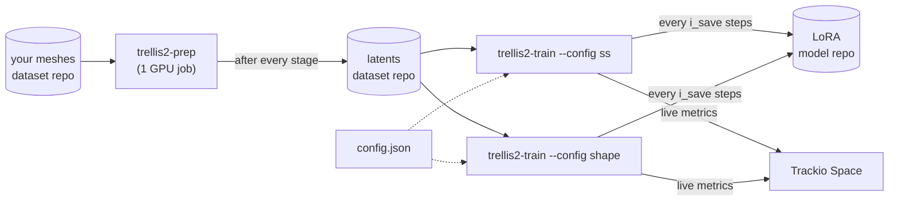

# Fine-tuning TRELLIS.2 geometry with LoRA: code release

Code for LoRA fine-tuning the two geometry flows of
[TRELLIS.2](https://github.com/microsoft/TRELLIS.2) (the sparse-structure flow and the
shape flow) on your own 3D meshes. We used it to adapt TRELLIS.2 to 188 shoes from
Google Scanned Objects. On 9 held-out shoes, Chamfer distance fell from 0.174 to 0.033
and F-score@0.02 rose from 0.28 to 0.80.

There are two ways to run it, and both do the same work:

- **With the containers** ([Using the containers](#using-the-containers)). The
  `trellis2-prep` and `trellis2-train` images take a Hub repo of meshes, turn it into
  latents and train LoRA adapters. They write everything back to the Hub, on HF Jobs or
  on your own GPU. You don't need to clone anything.
- **With the two scripts in this repo** ([One-script version](#one-script-version)):
  `preprocess.py` and `finetune.py` run inside the base image with this repo mounted,
  and are easy to read and change.

## Using the containers

### The images

| image | command | in | out |
|---|---|---|---|
| [`cr.hf.co/suvadityamuk/trellis2-finetuning`](https://huggingface.co/containers/suvadityamuk/trellis2-finetuning) | `bash` | | the base environment, for your own code or the [one-script version](#one-script-version). Mirrored on Docker Hub as [`hfsuvadityamuk/trellis2-starter`](https://hub.docker.com/r/hfsuvadityamuk/trellis2-starter) |
| [`cr.hf.co/suvadityamuk/trellis2-finetuning-prep`](https://huggingface.co/containers/suvadityamuk/trellis2-finetuning-prep) | `trellis2-prep` | a Hub repo of meshes | a dataset repo with every intermediate, the latents, the renders and a held-out split |
| [`cr.hf.co/suvadityamuk/trellis2-finetuning-train`](https://huggingface.co/containers/suvadityamuk/trellis2-finetuning-train) | `trellis2-train` | that dataset repo + a `config.json` | LoRA checkpoints in a model repo, metrics on a Trackio Space |

The images contain no weights or data. TRELLIS.2-4B (MIT) downloads on first use into
`/root/.cache/huggingface`. DINOv3, the image encoder that conditions training, is
gated under Meta's license, so it can't be redistributed in the image. Request access at
[facebook/dinov3-vitl16-pretrain-lvd1689m](https://huggingface.co/facebook/dinov3-vitl16-pretrain-lvd1689m)
and pass an `HF_TOKEN` from that account.

**You need:**
- A Hugging Face token with write access. For training, the token's account must also
  have been granted access to DINOv3. Preprocessing doesn't need DINOv3.
- 3D meshes, not images: training needs ground-truth geometry. Any format Blender
  imports works (`.glb`, `.gltf`, `.obj` with its `.mtl` and textures, `.fbx`, `.ply`,
  `.stl`, `.usd`), in any folder layout. Each mesh file becomes one object.
- On HF Jobs, nothing else. Locally, an NVIDIA GPU with 24 GB or more (see
  [GPU memory](#gpu-memory)) and Docker with the NVIDIA runtime.



### Launching a container

The commands inside the images are the same everywhere; only the launcher changes.

**On [HF Jobs](https://huggingface.co/docs/huggingface_hub/guides/jobs):**

```bash
hf jobs run -d --flavor a100-large --timeout 6h --secrets HF_TOKEN \
  cr.hf.co/suvadityamuk/trellis2-finetuning-prep:latest \
  trellis2-prep --meshes your-username/my-meshes --push-to your-username/my-meshes-trellis2
```

| flag | meaning |
|---|---|
| `-d` | detach: print the job ID and URL and return. Follow the job with `hf jobs logs -f <id>` |
| `--flavor a100-large` | the hardware. `l4x1` (24 GB) is enough for small datasets and short runs; `a100-large` (80 GB) suits real ones. `hf jobs hardware` lists them all |
| `--timeout 6h` | the job is stopped after this. Both commands resume, so a re-run continues where it stopped |
| `--secrets HF_TOKEN` | passes your token (from `HF_TOKEN` or `hf auth login`) into the job as an encrypted environment variable. It is never written into the image |
| `-e TRACKIO_SPACE_ID=...` | optional; the default for `trellis2-train --trackio-space` |
| `cr.hf.co/...:latest` | the image to run. Everything after it is the command run inside |

**With Docker, on your own GPU:**

```bash
docker run --gpus all --rm --shm-size 16g -e HF_TOKEN=hf_xxx \
  -v hf-cache:/root/.cache/huggingface -v "$PWD/work":/workspace/work \
  cr.hf.co/suvadityamuk/trellis2-finetuning-prep:latest \
  trellis2-prep --meshes your-username/my-meshes --push-to your-username/my-meshes-trellis2
```

| flag | meaning |
|---|---|
| `--gpus all` | expose the GPUs; use `--gpus '"device=1"'` to pick one |
| `--shm-size 16g` | DataLoader workers share batches through `/dev/shm`, and Docker's default is only 64 MB |
| `-e HF_TOKEN` | gated DINOv3 weights, downloads and uploads. `-e HF_TOKEN` with no value passes through the one exported on the host |
| `-e TRACKIO_SPACE_ID=...` | optional; the default for `trellis2-train --trackio-space` |
| `-v hf-cache:/root/.cache/huggingface` | keeps model weights and local Trackio logs between runs |
| `-v "$PWD/work":/workspace/work` | the working directory of both commands, kept on the host |
| `-v "$PWD/my_meshes":/meshes:ro` | for local meshes: mount them and pass `--meshes /meshes` |
| `-p 7860:7860` | only for a local Trackio dashboard (see [Training](#3-train-trellis2-train)) |
| `--rm` | delete the container on exit; everything worth keeping is in the volumes or on the Hub |

Leave out the command (`docker run ... -it <image> bash`) to get a shell instead.
Without `--push-to`, all results stay in `work/`.

### 1. Preprocess: `trellis2-prep`

Put your meshes in a Hub repo first, or mount a local folder when using Docker:

```bash
hf repos create your-username/my-meshes --repo-type dataset --private
hf upload your-username/my-meshes ./my_meshes . --repo-type dataset
```

Then run:

```bash
hf jobs run -d --flavor a100-large --timeout 6h --secrets HF_TOKEN \
  cr.hf.co/suvadityamuk/trellis2-finetuning-prep:latest \
  trellis2-prep \
    --meshes your-username/my-meshes \
    --push-to your-username/my-meshes-trellis2 \
    --private \
    --holdout 0.05 \
    --views 16 \
    --workers 8
```

| flag | default | meaning |
|---|---|---|
| `--meshes` | required | The Hub repo ID that has the meshes, or a local directory (Docker only) |
| `--meshes-repo-type` | `dataset` | Set to `model` if the meshes are in a model repo |
| `--meshes-include` | everything | Download only the files that match these globs, for example `--meshes-include 'chairs/**'` |
| `--push-to` | none | The dataset repo for the output. The container creates it if it does not exist. If you do not set it, the results stay local |
| `--private` | off | Make the `--push-to` repo private |
| `--max-objects` | all | Process only the first N meshes (sorted by path). Use it for a test run |
| `--holdout` | `0.05` | The fraction of objects to keep for evaluation. Training does not use them |
| `--seed` | `0` | The random seed for the held-out split. The same seed always gives the same split |
| `--views` | `16` | The number of conditioning renders for each object. Training selects one at random at each step |
| `--workers` | `8` | The number of parallel Blender processes. In our tests, more than approximately 8 can make Blender crash at startup |
| `--stages` | all | Run only some of the stages: `index mesh voxel shape ss render split export` |
| `--work` | `/workspace/work/prep` | The local working directory in the container |

It runs eight stages:

| # | stage | what it does | output |
|---|---|---|---|
| 1 | `index` | index every mesh file | `metadata.csv` |
| 2 | `mesh` | dump each mesh with Blender 4.5 | `mesh_dumps/` |
| 3 | `voxel` | O-Voxel dual grids at 512 and 1024 | `dual_grid_512/`, `dual_grid_1024/` |
| 4 | `shape` | shape latents at 512 and 1024 | `shape_latents/` |
| 5 | `ss` | sparse-structure latents (64³), from the 1024 shape latents | `ss_latents/` |
| 6 | `render` | conditioning views with Cycles (Blender 3.0) | `renders_cond/` |
| 7 | `split` | held-out split and ground-truth meshes | `holdout.txt`, `holdout_gt/`, `eval_testlist.txt` |
| 8 | `export` | every mesh as a portable `.glb` | `mesh_glb/` |

After each stage, it uploads the whole working tree to `--push-to`. If the repo already
has data, it downloads it first, and every stage skips the objects it already finished,
so re-running the same command resumes after a timeout. The repo ends up with:

| path | what | used by |
|---|---|---|
| `ss_latents/ss_enc_conv3d_16l8_fp16_64/` | sparse-structure latents | sparse-structure training |
| `shape_latents/shape_enc_next_dc_f16c32_fp16_512/` | shape latents | shape training |
| `renders_cond/<sha256>/` | 16 renders + camera poses per object | both (DINOv3 input) |
| `metadata.csv`, `holdout.txt` | object index and held-out split | both |
| `holdout_gt/`, `eval_testlist.txt`, `mesh_glb/` | ground-truth meshes and eval inputs | evaluation |
| `mesh_dumps/`, `dual_grid_512/`, `dual_grid_1024/`, `shape_latents/*_1024/` | intermediates | resuming, re-encoding |
| `README.md` | dataset card with per-stage counts | people |

Objects are keyed by the SHA-256 of their mesh file; `metadata.csv` maps each one back
to its path in your repo (`file_identifier`). For scale: 12 objects took 16 minutes on
an L4, about a third of it rendering. The per-object stages grow linearly with the
number of meshes; more `--workers` and a bigger flavor (more CPU cores) speed up
rendering.

### 2. Pick a config

`trellis2-train --config` takes a preset, a local file, a file on the Hub or a URL:

| value | what it loads |
|---|---|
| `ss` | our sparse-structure config ([`ss_flow_lora_gso.json`](container/trellis2/configs/lora/ss_flow_lora_gso.json)) |
| `shape` | our shape config ([`slat_flow_img2shape_lora_gso.json`](container/trellis2/configs/lora/slat_flow_img2shape_lora_gso.json)) |
| `hf://your-username/my-lora/configs/ss.json` | a file in a model repo (`hf://datasets/...` for a dataset repo) |
| `https://...` | any URL |
| `my_config.json` | a local path (inside the container) |

To write your own, copy a preset and change what you need. The fields that matter most:

| field | meaning |
|---|---|
| `ckpt` | which TRELLIS.2 flow to adapt. `sparse: false` means the sparse-structure flow; `sparse: true` means the shape flow |
| `rank`, `alpha`, `lora_targets` | LoRA size and the layers it wraps. The shape flow's MLPs are `SparseLinear` layers, which PEFT can't wrap, so its preset adapts attention only, at a higher rank |
| `lr`, `weight_decay`, `grad_clip` | AdamW settings |
| `batch_size`, `grad_accum` | micro-batch and accumulation; the effective batch is their product |
| `max_steps`, `i_save`, `i_log` | optimizer steps, checkpoint interval, Trackio logging interval |
| `p_uncond` | how often the image condition is dropped, for classifier-free guidance |

Upload your file with `hf upload your-username/my-lora ss.json configs/ss.json`. For
one-off changes, skip the file and override fields on the command line with
`--set max_steps=1000 i_save=100`.

### 3. Train: `trellis2-train`

```bash
hf jobs run -d --flavor a100-large --timeout 12h --secrets HF_TOKEN \
  cr.hf.co/suvadityamuk/trellis2-finetuning-train:latest \
  trellis2-train \
    --config ss \
    --latents your-username/my-meshes-trellis2 \
    --push-to your-username/my-trellis2-lora \
    --trackio-space your-username/trellis2-trackio \
    --set max_steps=3000 i_save=500
```

Then the same command with `--config shape` trains the shape flow. The two runs are
independent, so they can run at the same time as two jobs.

| flag | default | meaning |
|---|---|---|
| `--config` | required | A preset, file, `hf://` path, or URL (see [Pick a config](#2-pick-a-config)) |
| `--set` | none | `key=value` overrides for the config. The values are parsed as JSON |
| `--latents` | required | The `trellis2-prep` dataset repo, or a local directory with the same layout |
| `--latent-dir` | matches the flow | The folder in `--latents`, if you encoded with different settings |
| `--push-to` | none | The model repo for the checkpoints. The container creates it, with a model card, if it does not exist |
| `--push-path` | `--run-name` | The folder in `--push-to` |
| `--private` | off | Make the `--push-to` repo private |
| `--run-name` | `ss_lora` / `shape_lora` | Trackio run name and default folder name |
| `--trackio-space` | `$TRACKIO_SPACE_ID` | The Space for the dashboard. The container creates it if it does not exist. If you do not set it, Trackio keeps the logs locally |
| `--trackio-private` | off | Make the Trackio Space private (Spaces are public by default) |
| `--trackio-project` | `trellis2-lora` | The Trackio project. All runs in a project use the same dashboard |
| `--no-holdout` | off | Also train on the held-out objects |
| `--work` | `/workspace/work/train` | The local working directory in the container |

While it runs:
- **Checkpoints:** every `i_save` steps, `adapter-<step>.safetensors` (about 37 MB of
  LoRA weights, not a copy of the model) is written to `--work` and uploaded to
  `--push-to` under `--push-path`, next to the `config.json` that produced it.
- **Metrics:** loss, smoothed loss, gradient norm and learning rate go to Trackio every
  `i_log` steps. A non-finite loss raises a Trackio alert. With `--trackio-space`,
  Trackio keeps the metrics in a bucket named `<space>-bucket` next to the Space, so
  they outlive the job. Without it, they go to a local database under
  `/root/.cache/huggingface/trackio`. To view that, start the container with
  `-p 7860:7860`, run `trackio show --project trellis2-lora --host 0.0.0.0`, and open
  <http://localhost:7860>.
- **Resuming:** re-running the same command downloads the newest checkpoint from
  `--push-to` and continues from that step. Optimizer state restarts; the LoRA weights
  don't.

With the presets, 3000 steps took 7.2 hours for the sparse-structure flow and 3.6 hours
for the shape flow on one A100.

### GPU memory

Both presets use a micro-batch of 4 with 4 accumulation steps, the setting of our runs
on an 80 GB A100. On a 24 GB GPU (an L4, A10, RTX 3090 or 4090), add
`--set batch_size=2 grad_accum=8`. The effective batch is still 16, and we
smoke-tested that setting on an L4.

### Keeping the raw working directory too

The repos above hold everything training and evaluation need. To also keep the exact
working directory of a job (logs, partial outputs), mount a
[bucket](https://huggingface.co/docs/hub/storage-buckets) over it. Buckets are
writable from inside a job; mounted model and dataset repos are read-only:

```bash
hf buckets create your-username/trellis2-work --private
hf jobs run ... -v hf://buckets/your-username/trellis2-work:/workspace/work ...
```

### Limits

- Only geometry is fine-tuned; textures come from the base model.
- The held-out split keeps near-duplicates together using name rules written for GSO
  colorways (`..._in_Tan`, `..._Color_...`). With other naming it is effectively a
  seeded random split. To keep variants of one object together, name them
  `<model>_in_<variant>` (or `_Color_`, `_Size_`), or dedupe them first.
- Every mesh file is one object, so merge multi-part scenes into one file per object
  first.

## One-script version

`preprocess.py` and `finetune.py` do the same work as `trellis2-prep` and
`trellis2-train`, each in a single file you can read top to bottom. Run them in the
base image with this repo mounted:

```bash
git clone https://github.com/suvadityamuk/trellis2-finetuning && cd trellis2-finetuning
docker run --gpus all -it --rm --shm-size 16g -e HF_TOKEN=hf_xxx \
  -v hf-cache:/root/.cache/huggingface \
  -v "$PWD":/workspace/release -v "$PWD/work":/workspace/work \
  -w /workspace/release \
  cr.hf.co/suvadityamuk/trellis2-finetuning:latest
```

Inside the container:

```bash
# 1. meshes -> latents (any format Blender imports, any folder layout)
python preprocess.py --meshes /workspace/work/my_meshes --out /workspace/work/data

# 2. latents -> LoRA, one run per flow
python finetune.py --flow ss    --latents /workspace/work/data
python finetune.py --flow shape --latents /workspace/work/data
```

To skip step 1, train on our preprocessed shoes: pass
`--latents suvadityamuk/gso-footwear-trellis2-latents`, and only the files training needs
are downloaded. For a smoke test, add `--set max_steps=5 i_save=5`. On a 24 GB GPU,
add `--set batch_size=2 grad_accum=8` (see [GPU memory](#gpu-memory)).

### `preprocess.py`

This script runs the same eight stages as [`trellis2-prep`](#1-preprocess-trellis2-prep),
with the same resume behaviour and the same output layout.

| flag | default | meaning |
|---|---|---|
| `--meshes` | required | local folder, or a Hub repo ID holding the meshes |
| `--meshes-repo-type`, `--meshes-include` | `dataset`, everything | as for `trellis2-prep` |
| `--out` | `/workspace/work/prep/data` | output folder; this is what `finetune.py --latents` reads |
| `--push-to`, `--private` | none, off | dataset repo that receives the output after every stage; if it already has data, the run resumes from it |
| `--max-objects` | all | only the first N meshes, for a dry run |
| `--holdout`, `--seed` | `0.05`, `0` | held-out fraction and split seed |
| `--views` | `16` | conditioning renders per object |
| `--workers` | `8` | parallel Blender processes; going above ~8 makes Blender startups crash |
| `--stages` | all | any subset of `index mesh voxel shape ss render split export` |
| `--trellis-root` | `$TRELLIS2_ROOT` or `/workspace/TRELLIS.2` | the TRELLIS.2 tree to run the toolkit from |

### `finetune.py`

This script loads the pretrained flow and freezes it. It injects PEFT LoRA adapters
(the only trainable weights, kept in fp32) and trains them with the rectified-flow
velocity loss in bf16, with gradient checkpointing and gradient accumulation. Objects
in `holdout.txt` are left out of training. Checkpoints, metrics and resuming work as
in [`trellis2-train`](#3-train-trellis2-train).

| flag | default | meaning |
|---|---|---|
| `--flow ss\|shape` | | use our footwear hyperparameters for that flow (inlined at the top of the script) |
| `--config` | | or a JSON file, `hf://` path or URL (one of the two is required) |
| `--set k=v ...` | none | override single fields, e.g. `max_steps=1000 i_save=100 lr=5e-5` |
| `--latents` | required | `preprocess.py` output: local folder or Hub dataset repo |
| `--latent-dir` | matches the flow | the folder in `--latents`, if you encoded with different settings |
| `--output` | `/workspace/work/results` | adapters go to `<output>/<run-name>/adapter-<step>.safetensors` |
| `--run-name` | `ss_lora` / `shape_lora` | folder and Trackio run name |
| `--push-to`, `--push-path`, `--private` | none, `--run-name`, off | model repo that receives every checkpoint, the config and a model card |
| `--trackio-space`, `--trackio-project`, `--trackio-private` | `$TRACKIO_SPACE_ID`, `trellis2-lora`, off | as for `trellis2-train` |
| `--no-trackio` | off | print metrics only |
| `--no-holdout` | off | also train on the held-out objects |
| `--trellis-root` | `$TRELLIS2_ROOT` or `/workspace/TRELLIS.2` | the TRELLIS.2 tree to import from |

## Evaluate

`scripts/eval_geometry.py` (in every image, under `/workspace/TRELLIS.2`) generates a
mesh from one render of each held-out object, once with the base model and once with
the LoRA, using the same seed. It reports Chamfer distance, F-score and normal
consistency against the ground truth. Run it from the TRELLIS.2 root:

```bash
cd /workspace/TRELLIS.2
python scripts/eval_geometry.py \
  --test_list /workspace/work/data/eval_testlist.txt --mesh_dir /workspace/work/data/holdout_gt \
  --ss_adapter /workspace/work/results/ss_lora/adapter-3000.safetensors \
  --shape_adapter /workspace/work/results/shape_lora/adapter-3000.safetensors \
  --out_dir /workspace/work/eval --pipeline_type 512 --tau 0.02 --num_points 50000
```

## Rebuild the images

The build context is the root of this repo. The image compiles CUDA extensions, so
build it on a linux/amd64 host with plenty of RAM; `MAX_JOBS=6` needs about 64 GB.

```bash
docker build -f container/Dockerfile -t trellis2-finetuning .
docker build -f container/prep.Dockerfile  --build-arg BASE=trellis2-finetuning -t trellis2-finetuning-prep .
docker build -f container/train.Dockerfile --build-arg BASE=trellis2-finetuning -t trellis2-finetuning-train .
```

By default, CUDA kernels are built for Ampere, Ada and Hopper
(`TORCH_CUDA_ARCH_LIST="8.0;8.6;8.9;9.0"`). Pass a narrower list with `--build-arg` to
build faster. To use the code without Docker, check out upstream at `75fbf01`, run
`git apply container/patches/trellis2-75fbf01.patch`, copy `container/trellis2/` over
the checkout, and point the scripts at it with `--trellis-root` (or `$TRELLIS2_ROOT`).

## Credits and licenses

TRELLIS.2 is by Xiang et al. at Microsoft ([paper](https://arxiv.org/abs/2512.14692),
MIT; see `LICENSE`). Google Scanned Objects is by Google Research (CC-BY-4.0). DINOv3
is Meta's, under its own license; it is downloaded at run time and never
redistributed. Blender is GPL.
